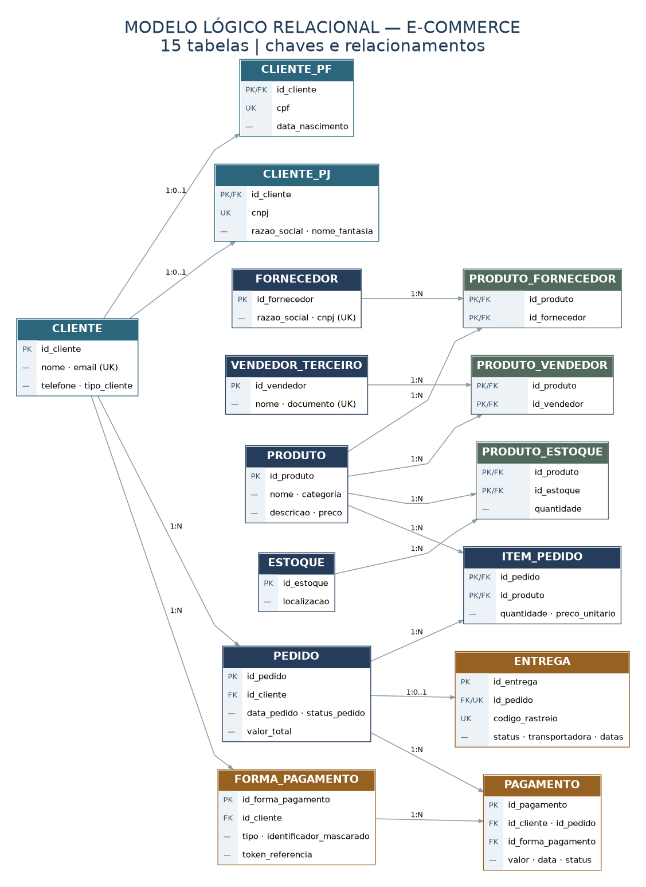

# Projeto Lógico de Banco de Dados — E-commerce

## Sobre o projeto

Este projeto é a continuação do desafio de modelagem conceitual de um e-commerce. Nesta etapa, transformei o modelo anterior em tabelas de um banco de dados relacional, definindo as chaves primárias, estrangeiras e algumas regras para manter os dados organizados.

Além de criar as tabelas, incluí dados fictícios para testar o funcionamento e preparei consultas SQL para responder perguntas comuns de uma loja virtual, como a quantidade de pedidos por cliente, os produtos de cada fornecedor e a situação das entregas.

O projeto foi feito em **PostgreSQL**, com scripts que podem ser executados pelo **pgAdmin 4**.

## Principais regras do modelo

**Clientes PF e PJ:** os dados comuns ficam em `cliente` e as informações específicas ficam em `cliente_pf` ou `cliente_pj`. Um cliente deve estar em **apenas uma** dessas duas tabelas. Essa regra é verificada pelo banco de dados ao finalizar a transação.

**Formas de pagamento:** um cliente pode cadastrar várias formas de pagamento, como cartão e Pix. A tabela `pagamento` registra as transações dos pedidos. Também foi incluída uma verificação para impedir o uso da forma de pagamento de outro cliente.

**Entregas:** cada pedido pode ter no máximo uma entrega, com status, código de rastreio, transportadora e datas.

**Produtos, fornecedores e vendedores:** os relacionamentos de muitos-para-muitos do modelo conceitual foram transformados em tabelas intermediárias: `produto_fornecedor` e `produto_vendedor`. O controle de quantidades fica em `produto_estoque`.

## Diagrama do modelo lógico

O arquivo [`modelo_logico.mmd`](diagramas/modelo_logico.mmd) permite visualizar e editar o diagrama em Mermaid. A pasta `diagramas` também contém a representação conceitual usada como ponto de partida.

## Arquivos do projeto

| Arquivo | Para que serve |
| --- | --- |
| `sql/01_criar_esquema.sql` | Cria as 15 tabelas, chaves, restrições e a regra PF/PJ. |
| `sql/02_inserir_dados.sql` | Insere clientes, produtos, pedidos, pagamentos, entregas e outros dados de exemplo. |
| `sql/03_consultas.sql` | Contém 16 consultas, com as perguntas que cada uma responde. |
| `sql/04_testes_integridade.sql` | Testes opcionais para verificar algumas restrições. |
| `diagramas/modelo_logico.png` | Imagem do modelo lógico. |
| `diagramas/modelo_logico.mmd` | Versão editável do diagrama. |

## Como executar no pgAdmin

1. Abra o **pgAdmin 4** e conecte-se ao seu servidor PostgreSQL.
2. Selecione um banco de dados de testes. Se ainda não tiver um, crie um chamado `ecommerce_desafio`.
3. Clique com o botão direito nesse banco e abra o **Query Tool**.
4. Abra o arquivo `01_criar_esquema.sql`, execute e aguarde a confirmação.
5. Depois execute o `02_inserir_dados.sql` para cadastrar os dados fictícios.
6. Por último, abra `03_consultas.sql` e execute as consultas. Você pode selecionar uma consulta por vez para ver o resultado de cada pergunta.

**Atenção:** o primeiro arquivo apaga e recria o esquema chamado `ecommerce`. Por isso, use um banco de testes e não execute novamente se tiver dados próprios nesse esquema que deseja preservar.

## O que as consultas mostram?

As consultas incluem `SELECT`, `WHERE`, `ORDER BY`, expressões para calcular valores derivados, `GROUP BY`, `HAVING`, `CASE` e vários `JOINs`. Algumas perguntas que elas respondem são:

- Quantos pedidos foram feitos por cada cliente?
- Quais clientes fizeram dois ou mais pedidos?
- Algum vendedor também é fornecedor?
- Quais produtos cada fornecedor oferece e quanto há no estoque?
- Qual é o valor total pago em cada pedido?
- Quais clientes possuem mais de uma forma de pagamento?
- O total de um pedido corresponde à soma de seus itens?

## Observações

Os nomes, documentos e pagamentos cadastrados são **fictícios** e servem apenas para demonstração. Os documentos têm o formato esperado, mas não representam cadastros reais.

O modelo utiliza especialização de clientes por meio de tabelas separadas. Como a validação da especialização é feita ao finalizar a transação, a inclusão de um cliente e de sua tabela PF ou PJ deve ocorrer no mesmo `BEGIN`/`COMMIT`, como mostrado no arquivo de dados.

O valor do pedido foi mantido como dado armazenado para acompanhar o modelo conceitual anterior. Há uma consulta específica para verificar se ele corresponde ao total calculado com base nos itens.
